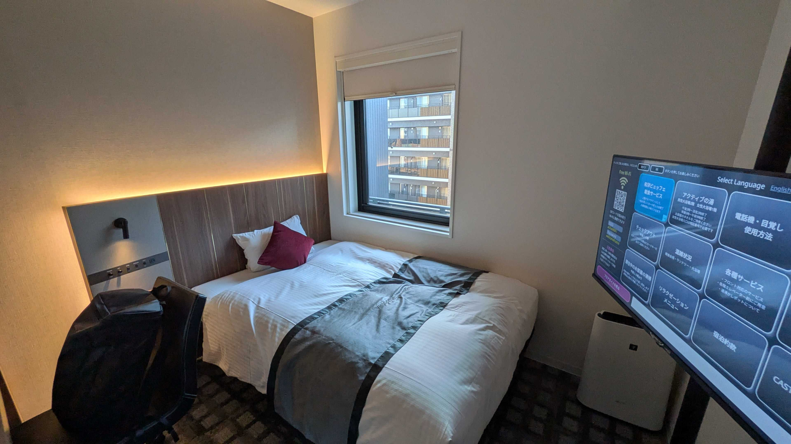
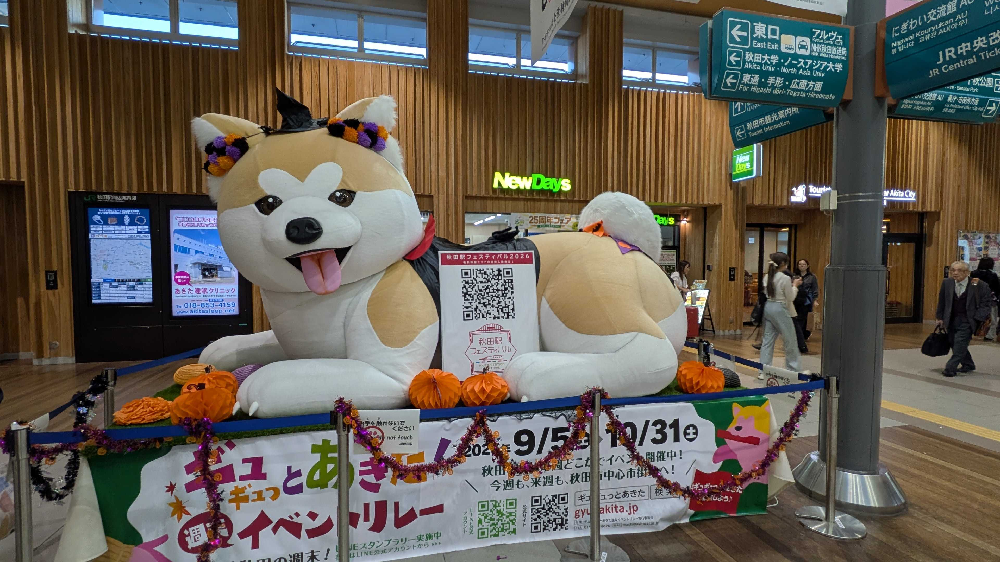
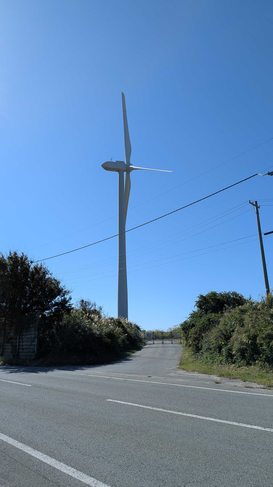
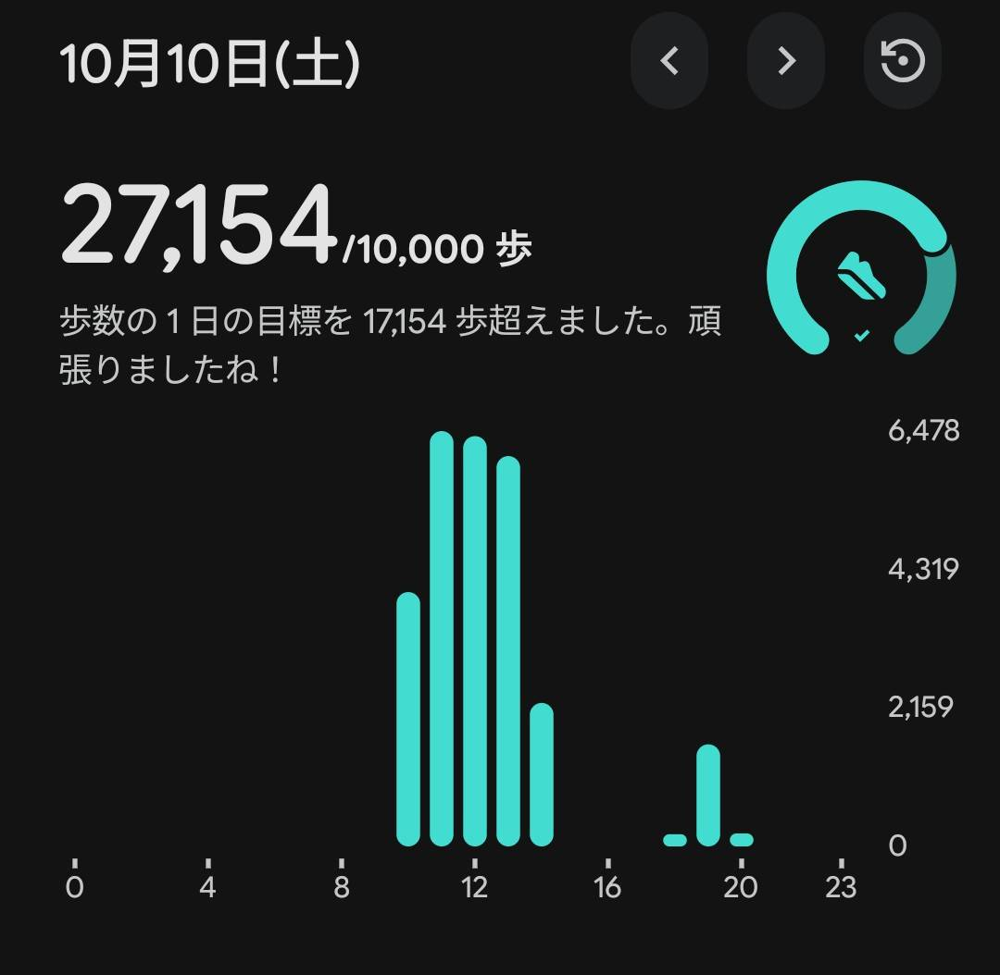
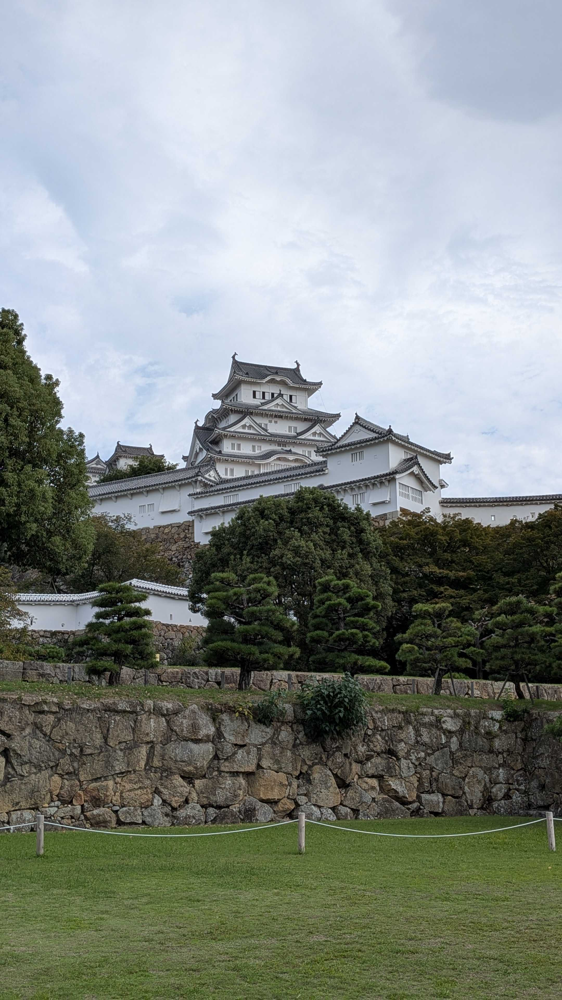
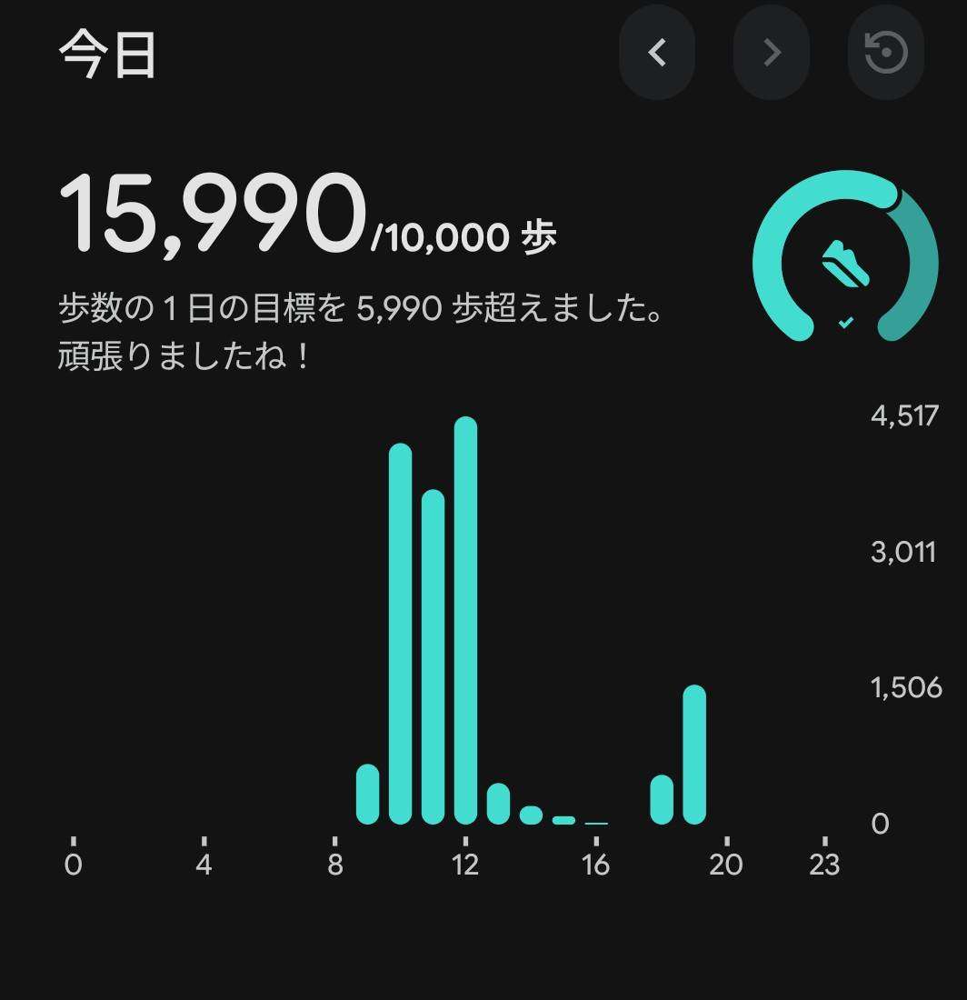

# 活動報告
最近はどうもイコちゃんらを連れてぬいどりする気分になれなかった。  

そういえば前にやっていた日経の企業キャラ総選挙で[イコちゃんが2位になった](https://x.com/ICOCA_shopping/status/2108392830456774769)らしい。 (めでたい)

直近東京の天気も悪くどこにも行けてなく、公私共に鬱憤がたまりまくっていたので羽休め的な意味でも思い切って休みを取って色々と行ってきた。

## 9/23：新山口
シルバーウイークは特に行くところを考えてなかった。  
何処にも行かないのもシャクなのでビジネスホテル堪能だけでもと前から気になってた新山口のホテルに行った。  

... ホテルに行っただけ
- [ホテルアクティブプレミア新山口 (じゃらん)](https://www.jalan.net/yad377157/)

## 10/9~10：秋田

夏季休暇が余っていたので10/7~9まで消化した。  
秋田には本当は土日に行きたかったんだけど新幹線が取れず、やむを得ず9~10で行くことにし、11~12日は別のところに行くことにした。

秋田駅ではでっかい秋田県の風船がお出迎え (可愛い...)

翌日は天気も良かったので海を見に行こうと歩いた。  
けれども通った場所がよろしくなかったのか海は少ししか見えなかった...   
代わりに風力発電機が何機か見えた。  

風力発電機は意外と初めて見るかもしれない。

この日は結構歩いた。  
それでも3万はいってないのかという感じだが...  

## 10/11~12 加古川 → 姫路
何故加古川かって? スーパーホテルに行きたい気分やったんや...  
加古川は目立って見どころとかもない普通の街なので特に何も撮影していない。

すぐ横には姫路なのでついでに行った。  
姫路城は小学校の卒業遠足で行ったきりだったので10数年ぶりか。  

相変わらず観光客が多くて中に入る気も起らなかったので  
周辺をぐるっと歩いて終わり。

# おわりに
連休はやっぱり人も多い。  

これまで休暇は連休の前後に入れることも多かったけど、  
今後は少しずらしたタイミングの方が快適に色々巡れるのかも。

とはいえバカンスに来てる外国人には祝日なんて関係なくだろうが...

