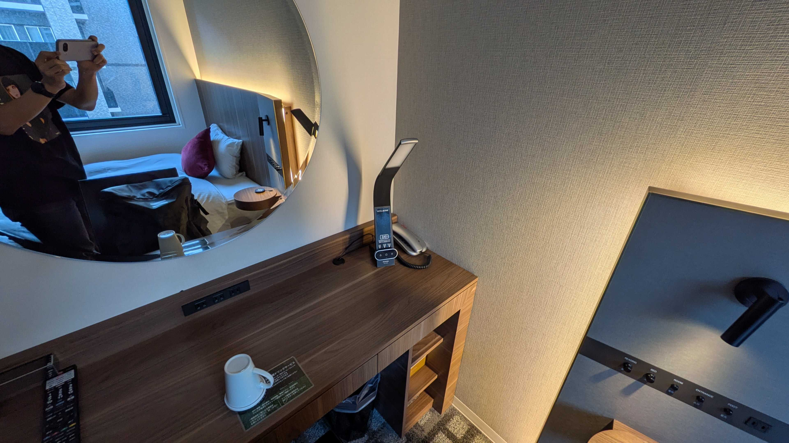
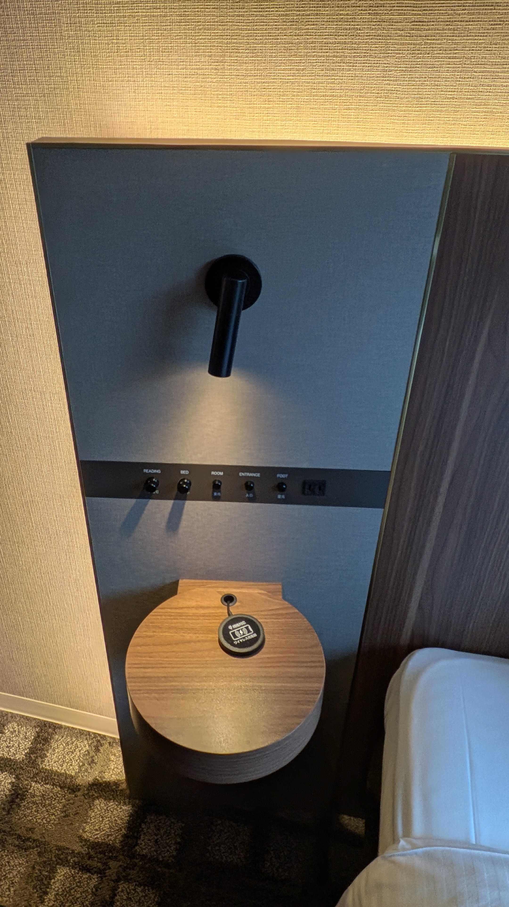

# 今回のレポ
SWの予定を特に考えておらずに先週までどこにも行くつもりはなかった。  
1週間前にとっさに前々から気になってた新山口のビジホ行くかとなって予約を入れて22~23日で行った。 

ホテルの詳細は↓  
- [ホテルアクティブプレミア新山口 (じゃらん)](https://www.jalan.net/yad377157/)

## 詳しく
駅のすぐ横にあって、新築なのか外観はかなり綺麗。  

撮影はしていないが、各客室フロアのエレベーター口にはコーヒーや紅茶などのホットドリンクバーが設置してあったり、  
電子レンジも設置してあって中々ええやん！と思ったけど、よくよく思い出してみると部屋にケトルが無かった気がする....

大浴場は炭酸風呂で浴槽には青色のライトが照らされてる。  
新築のスーパーホテル感あってよかったけど、自分が行った時間帯故に人が多くてゆったりできんかったのが残念...

### 部屋レポ
部屋もとてもよい。こういうので良いんだよって感じ。 

皆大好きテレビのメニュー画面。  
VODやミラーリングは一通りそろってるけど、スーパーホテルのようなリラクゼーションサウンドを流すのはなかった。(残念)  

明るさを細かく弄れて部屋をいい感じに薄暗くできる。  
ワイヤレス充電器も有難かった。  

# おわりに
今年宿泊したホテルの中でも上位を争うくらい満足。  
だけど駅前とか周辺とかは正直なんもなく... もうちょい調べてから行けばよかったと思ったが、それはまた次の機会に
