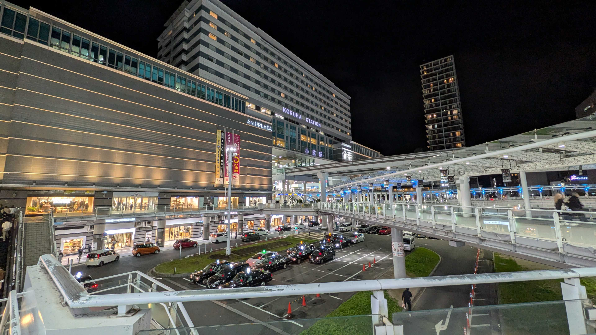
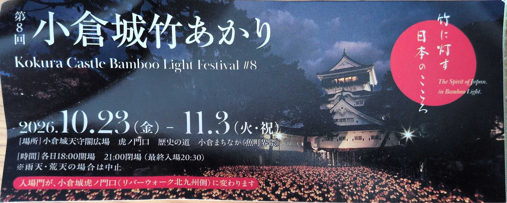
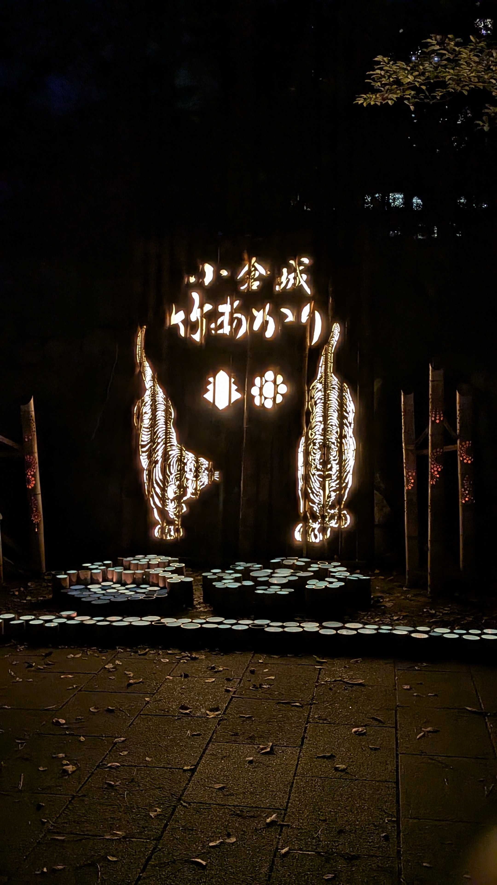
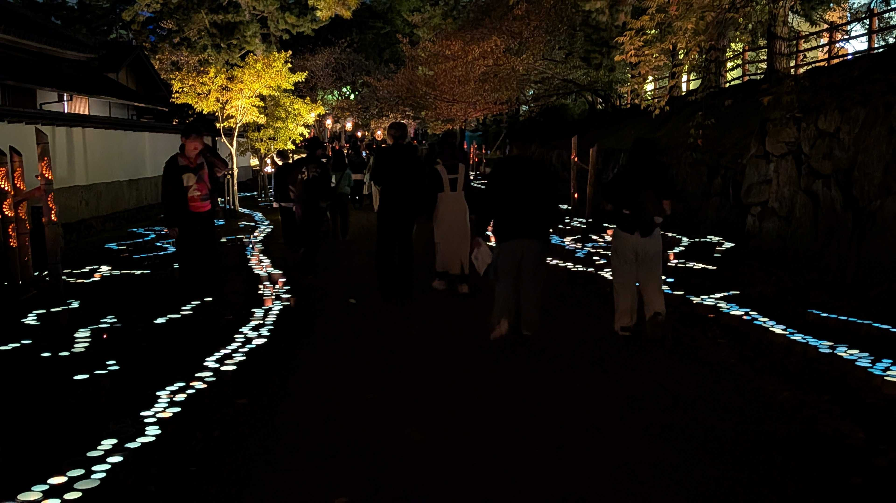
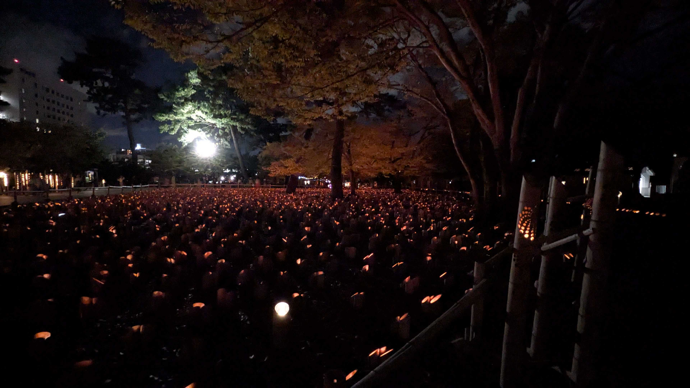
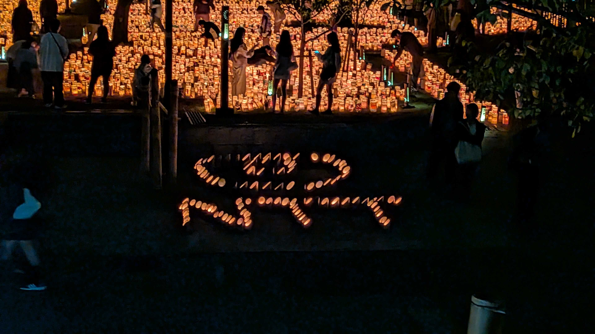
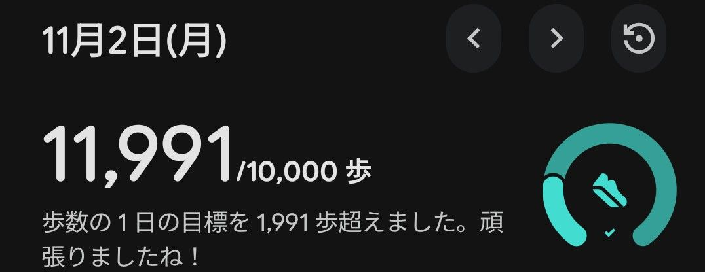
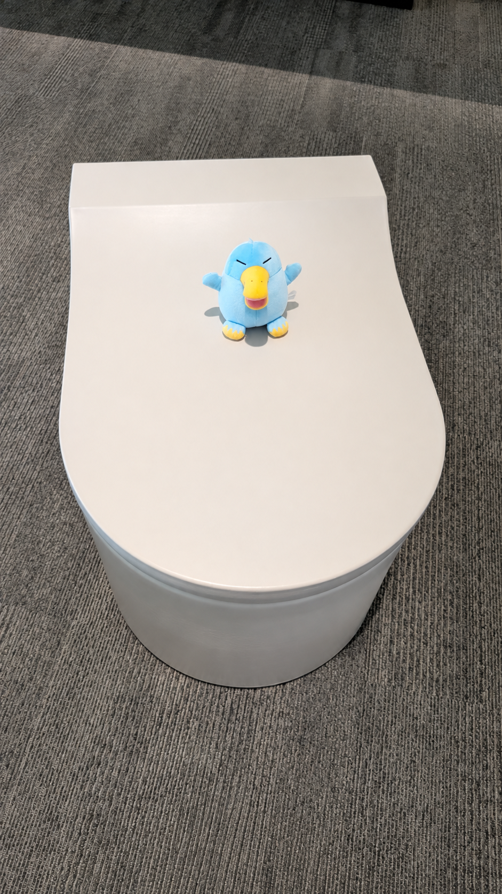
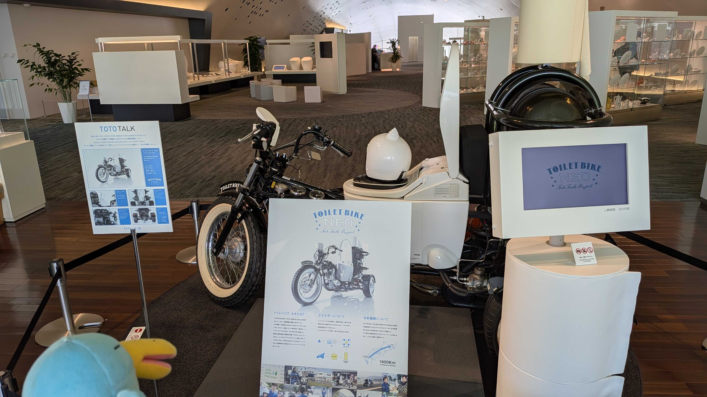

# 活動報告
10/30より会社のウォーキングイベントが開始。  
11/3は祝日ということで↑やぬいどりも兼ねて、今回は<b>北九州(小倉)</b>に行ってきた。

## 1日目 (11/2)
ホテルに着いた後、いざ飯を食おうと街を歩いていたら丁度小倉城が見えたので行ってみると...  

[小倉城竹あかり](https://kokurajotakeakari.com/about/)というイベントがやっていた。  
何やら放置竹林の竹を有効活用する形で灯籠を作り、城周辺に1,6000個飾るというものらしい。  

入場料は￥1000、折角来たので入ってみることにした。   
入口から綺麗にお出迎え。   

夜のライトアップは結構好きなので棚から牡丹餅ってところか。  
ただこういうのは静かに見たいかな... (人が多すぎて割とガヤガヤしていた)  

NTTのロゴを模った灯籠も発見！(本イベントはNTT西もスポンサードしてるらしい)  

この日の歩数。イベントの一日目安の8000歩は達成。  
ホテルも城も駅から結構近かったので、そこまで大きくは伸びず。

## 2日目(11/3)
[TOTOミュージアム](https://jp.toto.com/knowledge/visit/museum/museum_exhivision/)に行ってみた。小倉駅からは歩いて20分ほど  

その名の通り、TOTO製品に関する歴史や製品の変遷が展示されていた。  
1Fはショールーム、2Fが博物館になっており、博物館の入場料は無料(太っ腹！)。  

便器、便座、バスルームなどの技術の変遷や背景など見てて面白かった... のだが、  
いかんせん題材が斬新で、多分こういう機会でもなければこういうテーマの展示会には行かへんやろな～wと思った。  

第一展示場の映像ブースにて。椅子も便座の形で凝ってるな～と。

トイレバイク ネオなるものも展示されていた。  
バイオエネルギーが動力源のバイクらしく、実際に数十キロ走った実績もあるよう。  
イコちゃんも「はえ～」って感じで見物。  

今日もノルマの8000歩は達成。  
見どころさんがほぼ駅周辺に完結していて歩数は大体こんな感じか。  

# おわりに
中々面白かった。  

歩数的には前日六本木辺りをグルグル回ってた方が稼げたけれども、  
折角歩くのであれば見知らぬ街を歩いた方がやっぱり刺激的で面白いなと思った。  

明日・明後日は天気もよろしくないみたいだし、仕事だし、ちょい歩数は落ちるかも。
